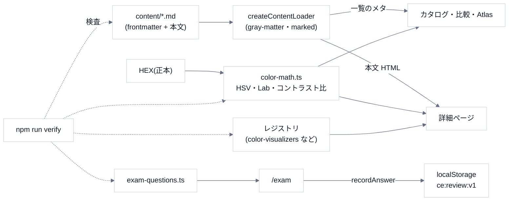

# 1. 全体像

## データの流れ

## ページ

| パス | 内容 |
|---|---|
| `/` | 入口(収録数は実データから算出) |
| `/colors`・`/colors/[id]` | 色図鑑。詳細は数値・方式の比較・コントラスト比・可視化 |
| `/shapes`・`/shapes/[id]` | 図形図鑑。作図手順の可視化・平面 / 立体の切り替え |
| `/atlas` | 色相×彩度・色相×明度・色立体(3D) |
| `/compare`・`/compare/shapes` | 最大 4 件の比較(`?ids=a,b`) |
| `/exam`・`/exam/[level]`・`/exam/review` | 級別の問題・復習 |
| `/basics` | 色の基礎 |

## データの置き場所

| もの | 場所 | 補足 |
|---|---|---|
| 収録 | `content/`(Git に入る) | 唯一の正本。数値は HEX から計算する |
| 検定問題 | `src/data/exam-questions.ts` | 自作問題。過去問の転載ではない |
| 解答の履歴 | **ブラウザの localStorage**(`ce:review:v1`) | 端末ごと。JSON の書き出し・読み込みで移す |
| サーバー・DB | **無い** | 静的に近い構成 |

## コマンド・環境

| コマンド | 役割 |
|---|---|
| `npm run dev` / `build` / `start` / `lint` | 開発・ビルド |
| `npm run verify` | コンテンツ・計算・可視化の検査(`node --experimental-strip-types`) |
| `npm run exam-table` | 級ごとの問題と参照エントリの表を出力 |

- **Node 22 以上**(TypeScript をそのまま読み込む `--experimental-strip-types` を使う)。
- 主な依存: `next` 16・`react` 19・`gray-matter`・`marked`・`three`・`pixi.js`。

## やらないこと(範囲の外)

- **色彩検定の公式範囲との対応の保証**(確認していない)。
- **PCCS・マンセルの色立体の計算**(対応表が要るため)。数値としては載せない。
- ユーザー登録・サーバー保存(履歴は端末の中だけ)。
